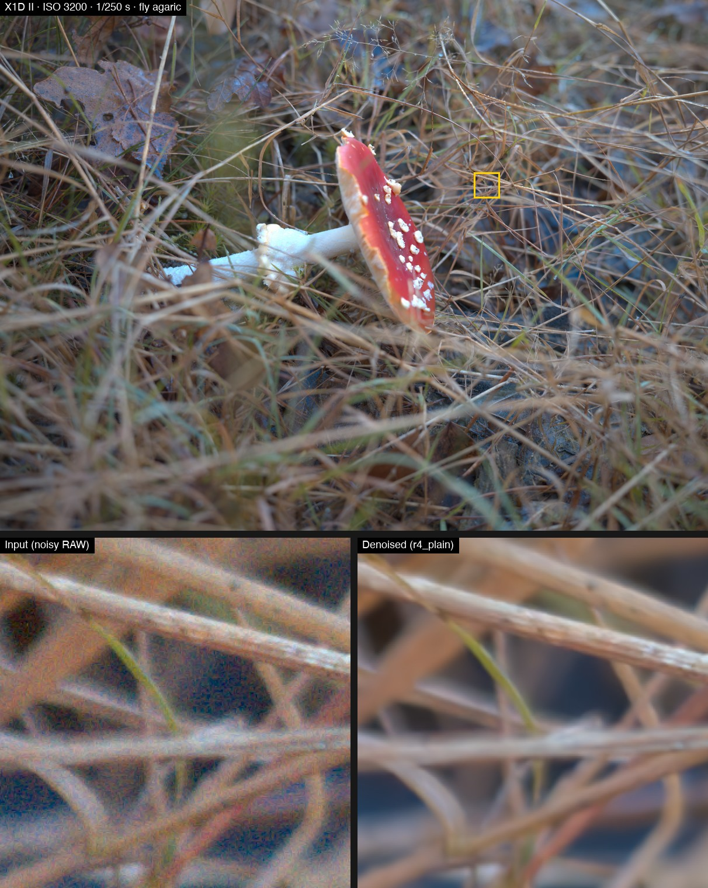
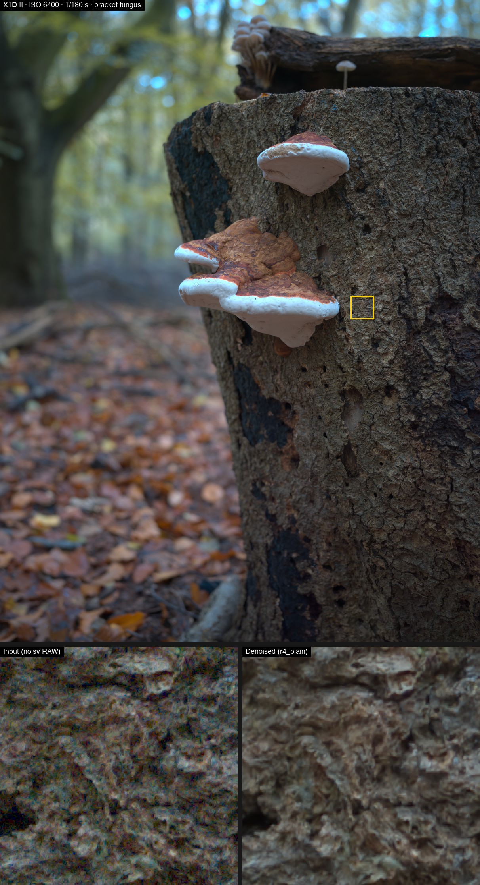
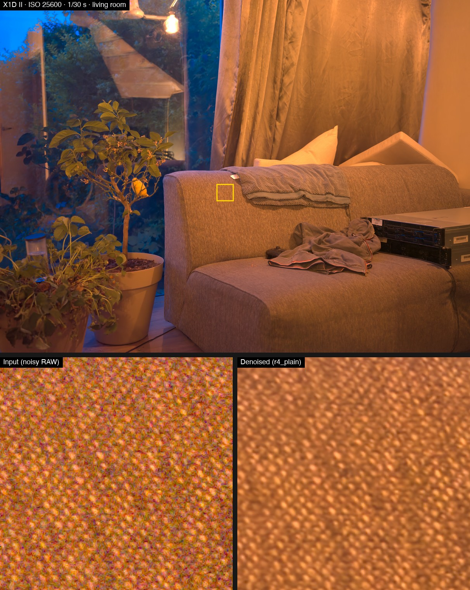
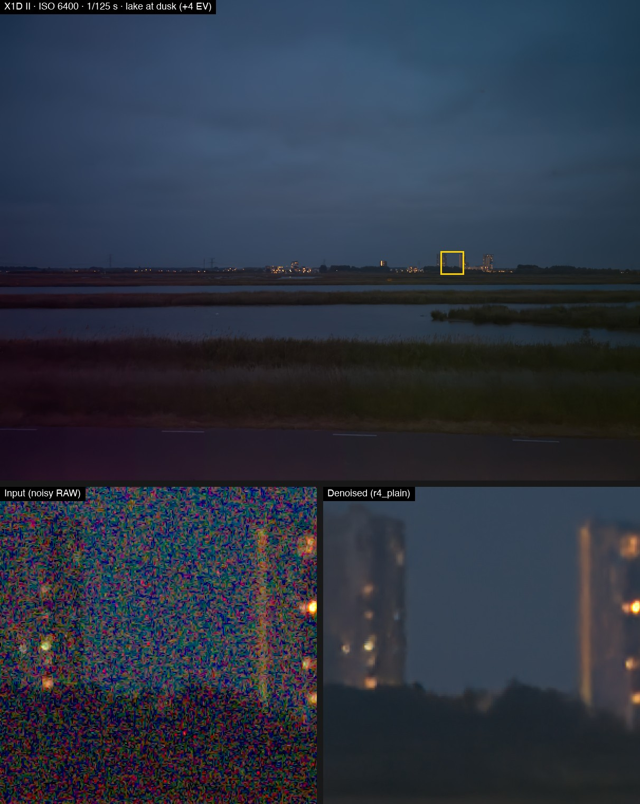
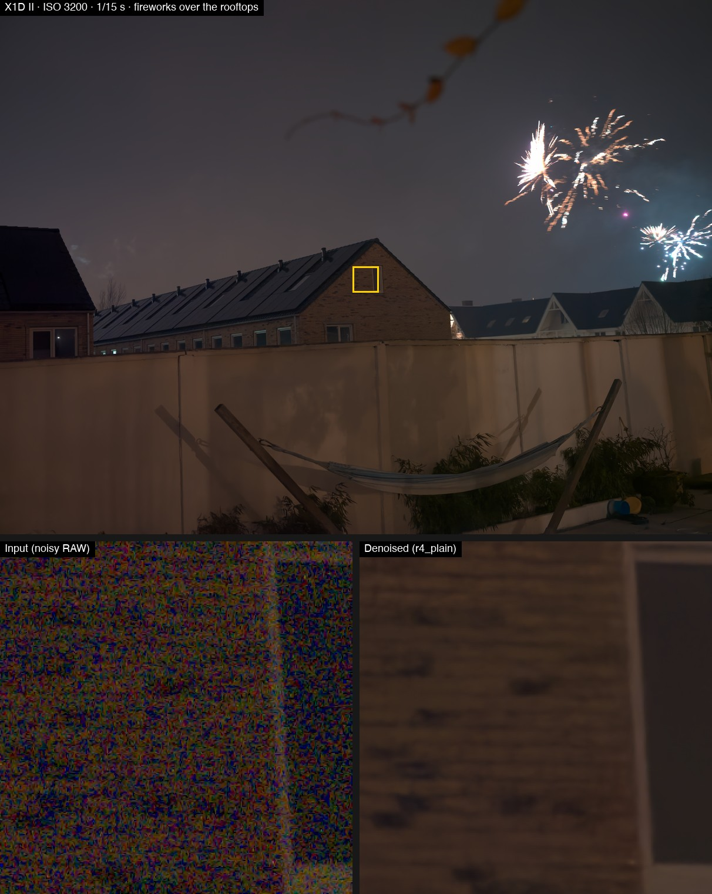
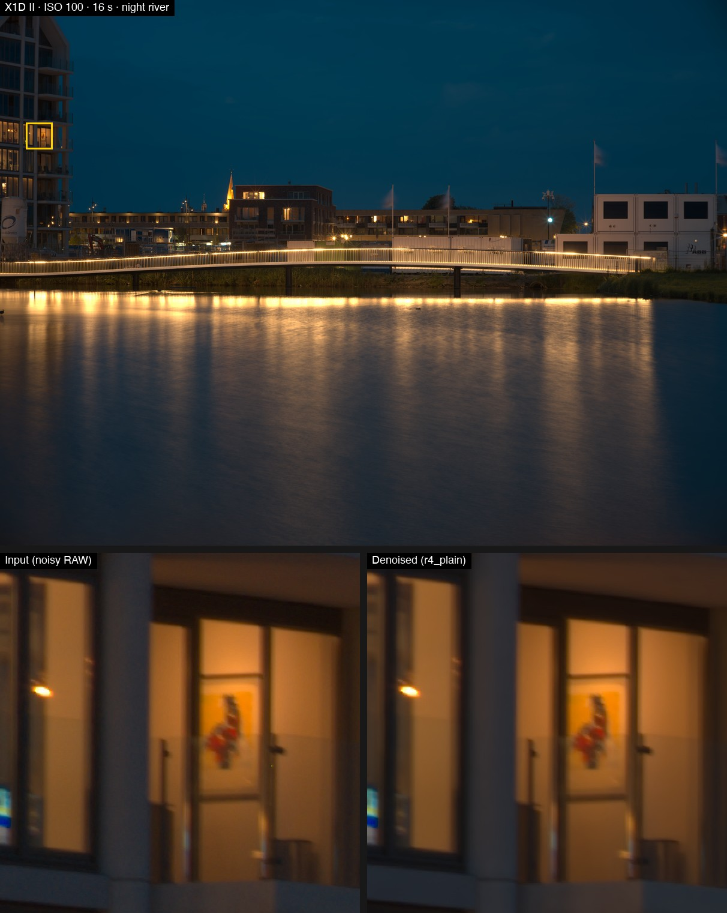

# rawdenoise-lab

## What it is

An experimental neural denoiser for Bayer RAW photographs, operating on sensor data before demosaicing. The repository includes a cross-platform command-line tool, independently trained model artifacts distributed through releases, and research tools for noise modelling, training and evaluation.

> **Research preview.** `r4_plain` was trained for the Hasselblad X1D II using private photographs and synthetic noise. It has no independent real paired-ground-truth evaluation or completed blind acceptance review. Other Bayer cameras may run, but their denoising quality is unvalidated.

## Examples

Qualitative examples from X1D II photographs processed with `r4_plain`:

- **Top of each image:** the denoised frame, with the crop marked in yellow.
- **Bottom of each image:** that crop at 2× (nearest neighbour), noisy input on the left and denoised output on the right.

Input and output use the same camera white balance, sRGB rendering and exposure lift. These illustrations are not paired-ground-truth quality measurements. They were made with `scripts/make_examples.py`.

| | |
|---|---|
|  |  |
| **ISO 3200, 1/250 s.** Grass and mushroom detail example. | **ISO 6400, 1/180 s.** Bark and fungus texture example. |
|  |  |
| **ISO 25600, 1/30 s.** Interior and fabric texture example. | **ISO 6400, pushed +4 EV.** Extreme shadow-lift example with visible fine-detail loss. |
|  |  |
| **ISO 3200, 1/15 s.** Bright fireworks and dark-sky example. | **ISO 100, 16 s.** Long-exposure river and buildings example. |

Known limitations are visible here: clipped highlights can acquire a faint cyan fringe, and the defect pre-pass can remove isolated single-pixel stars (use `--no-prepass` for astrophotography).

## Quick start

Use Python **3.11 or newer**. From a terminal:

```bash
git clone https://github.com/sndstone/rawdenoise-lab.git
cd rawdenoise-lab
python3 -m venv .venv
source .venv/bin/activate
# Windows PowerShell: .venv\Scripts\Activate.ps1
pip install -e ".[onnx]"

gh release download model-r4_plain-2026-10-30 --repo sndstone/rawdenoise-lab --pattern r4_plain_fp32.onnx --dir models
rawdenoise examples/raw/sample_iso3200_mushroom.dng --model models/r4_plain_fp32.onnx
```

Without GitHub CLI, download `r4_plain_fp32.onnx` from the [model release page](https://github.com/sndstone/rawdenoise-lab/releases/tag/model-r4_plain-2026-10-30), create `models/` and place it there. The three small demo DNGs are already in `examples/raw/`.

The command writes `examples/raw/sample_iso3200_mushroom_denoised.dng`. By default outputs go beside each input with `_denoised` added to the filename. Use `--output-dir outputs` to choose another directory. Existing files and inputs are never overwritten.

## Model files

Download these separately from the [release](https://github.com/sndstone/rawdenoise-lab/releases/tag/model-r4_plain-2026-10-30); keep model artifacts under `models/`.

| Release asset | Purpose |
|---|---|
| `r4_plain_fp32.onnx` | Recommended portable fp32 ONNX inference model |
| `r4_plain_weights.pt` | PyTorch weights and model configuration |
| `r4_plain_fp16.mlpackage.zip` | Core ML package; unzip under `models/` before use on macOS |
| `MODEL_CARD.md` | Training scope, model details and limitations |
| `SHA256SUMS` | SHA-256 checksums for verifying downloaded assets |
| `sample_iso3200_mushroom.dng` | Demo Bayer crop, also included in the repository |
| `sample_iso25600_living_room.dng` | Demo Bayer crop, also included in the repository |
| `sample_iso100_night_river.dng` | Demo Bayer crop, also included in the repository |

Read the model card before using the checkpoint. Download `SHA256SUMS` alongside the artifacts and compare each downloaded file's SHA-256 with its listed entry (for example, `sha256sum models/r4_plain_fp32.onnx` on Linux).

## Using your own RAWs

From the repository root:

```bash
rawdenoise photo.3FR other.DNG --model models/r4_plain_fp32.onnx --output-dir outputs --device cpu
rawdenoise photo.ARW --model models/r4_plain_weights.pt --strength 0.7
rawdenoise photo.3FR --model models/r4_plain_fp32.onnx --format tiff
rawdenoise --help
```

Bayer inputs must be rawpy-readable 2×2 RGB Bayer RAWs (RGGB, BGGR, GRBG or GBRG). X-Trans and Foveon are unsupported. Only unconditioned models are supported. Successful decoding from another camera does not validate its denoising quality.

**16-bit RGB TIFF is a separate experimental path.** It requires a three-channel `rgb_nafnet` PyTorch checkpoint with matching explicit color-space/ICC metadata; released Bayer weights cannot process RGB. No trained RGB weights or RGB denoising quality are provided. RGB inference preserves 16-bit codes through float32 normalization and rounded uint16 TIFF output, with no 8-bit conversion. See [RGB model, color contract and paired training recipe](docs/10-rgb-tiff.md).

```bash
# Requires your own trained RGB checkpoint; this is not a shipped model.
python scripts/train_rgb.py --manifest data/rgb/pairs.json --output runs/rgb/experimental.pt --device cpu
rawdenoise photo.tif --model runs/rgb/experimental.pt --device cpu --rgb-color-space srgb
```

RGB defaults to TIFF output and rejects DNG/NPY. ICC bytes, orientation and TIFF resolution are retained; unsupported color transforms and checkpoint mismatches fail. Untagged, unprofiled inputs need an explicit declaration of their actual encoding. Bayer CLI defaults and output formats remain unchanged.

| Backend | Install | Platforms and device selection |
|---|---|---|
| PyTorch `.pt` | `pip install -e .` | Windows, Linux, macOS; auto selects CUDA, then MPS, then CPU |
| ONNX CPU `.onnx` | `pip install -e '.[onnx]'` | Windows, Linux, macOS |
| ONNX CUDA `.onnx` | `pip install -e '.[onnx-gpu]'` | Windows/Linux with compatible NVIDIA CUDA libraries |
| ONNX DirectML `.onnx` | `pip install -e '.[directml]'` | Windows |
| Core ML `.mlpackage` | `pip install -e '.[export]'` | macOS with coremltools |

Choose one ONNX Runtime variant per environment. ONNX auto selects available providers in CUDA, DirectML, Core ML, CPU order. `--device cpu` forces CPU; ONNX and Core ML accept only `auto` or `cpu`. PyTorch also accepts device strings such as `cuda:0` or `mps`; install a suitable PyTorch build for your accelerator. **Torch is still required for preprocessing and tiling when using ONNX or Core ML.** `--backend` can override selection by model suffix.

`--strength` blends the complete processed result against the original, from 0 (preserve input) to 1 (full processing). `--no-prepass` disables hot/dead-pixel correction. `--overlap` controls tile overlap in packed pixels (default 60; twice that extent in sensor pixels).

The default DNG output contains the visible sensor mosaic rounded/clipped to uint16, with source CFA layout, black/white levels, color matrix, camera white balance and orientation. This minimal writer does not preserve other EXIF, lens profiles, masked pixels, previews or signatures. Retain the original RAW. `--format tiff` renders a 16-bit sRGB preview using camera white balance without automatic brightening. `--format npy` saves the signed float32 normalized visible mosaic in the source CFA layout without metadata.

## Local demo app

The local browser demo imports one Bayer RAW photo, processes it on this computer,
and exports a DNG mosaic or a rendered 16-bit TIFF. From the repository root:

```bash
PYTHONPATH=src .venv/bin/python -m denoise_lab.demo --model models/r4_plain_weights.pt
```

Open the local URL printed in the terminal, choose a RAW, select the export format,
then process and download the result. The demo defaults to explicit CPU FP32 and
requires trusted local PyTorch weights. The optional guarded Mac GPU mode is
experimental; NPU prototypes failed fidelity and are not offered. See the
[demo setup, import/export instructions and limitations](docs/13-demo-app.md).

## How it works

The model uses NAFNet (Nonlinear Activation Free Network), a neural image-restoration architecture. Preprocessing subtracts black levels, normalizes by sensor white levels, corrects likely defective pixels, and packs each 2×2 Bayer cell into R/G1/B/G2 planes. Inference runs on overlapping 512×512 packed-pixel tiles, blends them with feathered weights, and reconstructs the sensor mosaic. The released model was trained from random initialisation with synthetic noise on private photographic targets.

## Limitations

- The released checkpoint targets X1D II data; other cameras and real noise conditions need independent validation.
- Private training photographs are unavailable, so the complete training experiment cannot be reproduced from this checkout.
- Synthetic scores and qualitative examples do not replace independent paired references or blind acceptance review.
- Fine texture can be lost, clipped highlights can develop colour artifacts, and defect correction can remove isolated stars.
- Overlap blending does not guarantee tile-phase-independent neural predictions or eliminate all seams.
- Output metadata is limited; preserve original files and inspect results before further processing.

### Data-provenance ground rules

1. Training starts from random initialisation. Training targets and model-selection evidence must have documented independent provenance. Do not initialise, fine-tune or distil from third-party weights, or use third-party denoised outputs as targets, pseudo-labels or selection signals.
2. Every training file needs a recorded source and applicable usage terms; see [data guidance](docs/03-data.md). Data restricted to non-commercial use must not feed models intended for shipment. Verify terms for the exact dataset version and intended use before inclusion.
3. Data and weights stay out of git. Ignore rules cover local data directories and common model/RAW formats. The only RAW exceptions are the three approved 1024×1024 crops of the owner's photographs in `examples/raw/`; these are CLI examples and never training data.
4. Acceptance requires matched real-photo checks per camera/ISO band, independent clean references where available, and the owner's blind visual review. Synthetic peak signal-to-noise ratio (PSNR) gains alone never promote a model; see [evaluation](docs/05-evaluation.md).

## Research and docs

| Document | Scope |
|---|---|
| [01 — Deployment contract](docs/01-what-we-know.md) | Tensor layout, tiling and runtime interface |
| [02 — Approach](docs/02-approach.md) | Historical proposal and research roadmap |
| [03 — Data](docs/03-data.md) | Provenance, capture protocols and data preparation |
| [04 — Training](docs/04-training.md) | Historical prototype recipes and training/export notes |
| [05 — Evaluation](docs/05-evaluation.md) | Metrics and acceptance requirements |
| [06 — Provenance](docs/06-clean-room.md) | Independent implementation and training provenance |
| [07 — Architecture study](docs/07-architecture-study.md) | Historical architecture experiments, superseded by later rounds |
| [08 — Round 2](docs/08-nafnet-round2.md) | Historical capacity and training-length experiments |
| [09 — Clean targets and defects](docs/09-clean-targets-and-defects.md) | Later training rounds, target preparation and defect handling |
| [10 — RGB TIFF](docs/10-rgb-tiff.md) | Experimental three-channel model, 16-bit/color contract and independent paired training |
| [11 — Precision and evaluation](docs/11-precision-and-evaluation.md) | Export precision, EMA compatibility and matched inference experiments |
| [13 — Local demo app](docs/13-demo-app.md) | Browser RAW import, processing and DNG/16-bit TIFF export |
| [References](docs/references.md) | Papers and research resources |

The code and configs retain exploratory experiments. Historical recipes are not the released model's training instructions. `scripts/train_arch_study.py` supports the later binned-target/defect/EMA experiments; `scripts/train.py` also provides the small smoke fixture below. `scripts/run_cuda.py` is optional research tooling requiring a separately prepared Docker/NVIDIA environment.

## Development

From the repository root in the activated environment:

```bash
pip install -e '.[dev,onnx]' onnx
pytest -q tests/
python scripts/train.py --config configs/smoke.yaml --device cpu
```

The 20-step smoke run uses random fixtures and illustrative calibration, writes `runs/smoke/last.pt`, and checks training plumbing only. It does not produce a camera denoising model. See [CONTRIBUTING.md](CONTRIBUTING.md) for contribution and provenance requirements.

For export, install `pip install -e '.[export]'`. ONNX export includes an ONNX Runtime CPU parity check; `--weights ema` selects EMA weights when present (also supported by the Core ML exporter). For example:

```bash
python scripts/export_onnx.py --checkpoint models/r4_plain_weights.pt --output models/r4_plain_fp32.onnx --precision fp32 --dynamic
```

Dynamic height/width must be multiples of 16 for the four-stage model. Deployment uses 512 packed-pixel tiles.

New exports default to fp32 computation to preserve input precision. Half-precision
computation is an explicit approximation requiring low-ISO shadow and sensor-DN
checks; see [precision guidance](docs/11-precision-and-evaluation.md). Existing
fp16 release packages retain their original precision.

Bayer tiling mirrors the sensor mosaic with its CFA-site offsets. Older per-plane
reflection could introduce colored grids near reflected borders; updating weights
alone does not correct an older host tiler. See [precision and runtime guidance](docs/11-precision-and-evaluation.md).

## License

No license has been chosen yet; until a LICENSE file is added, all rights are reserved by the author.
