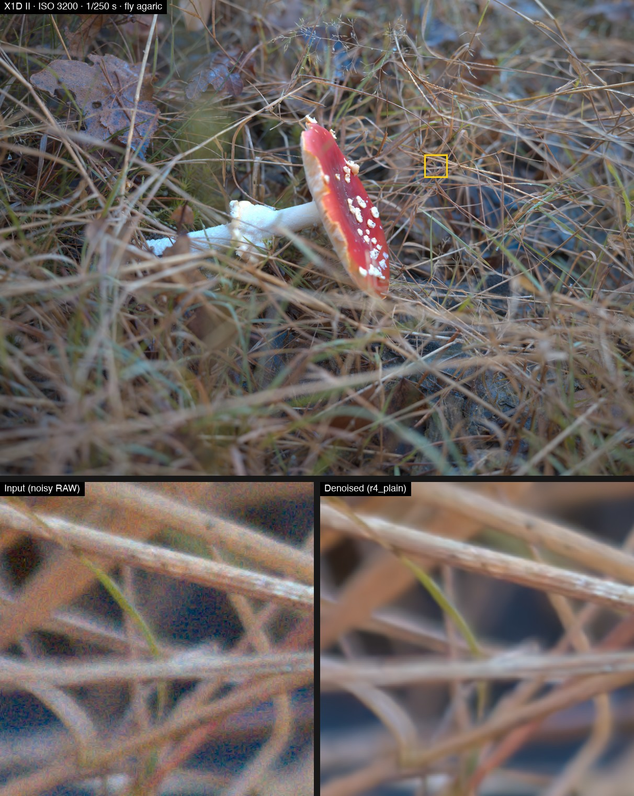
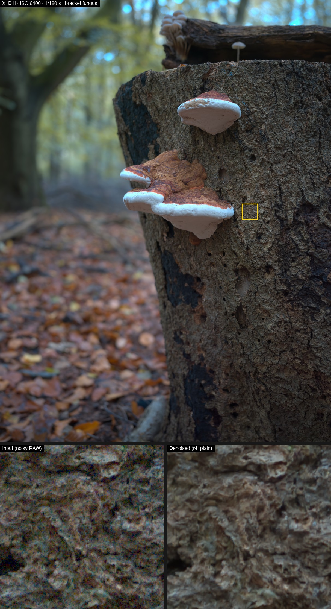
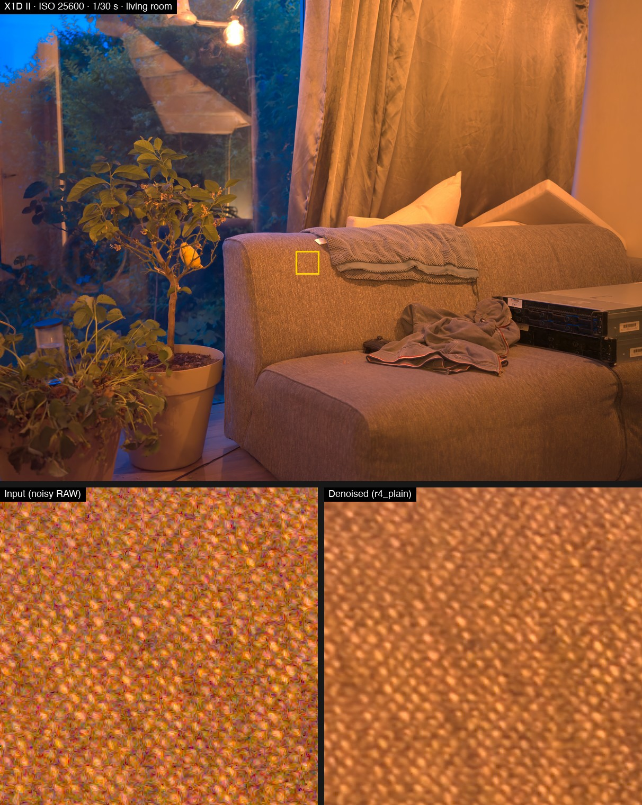
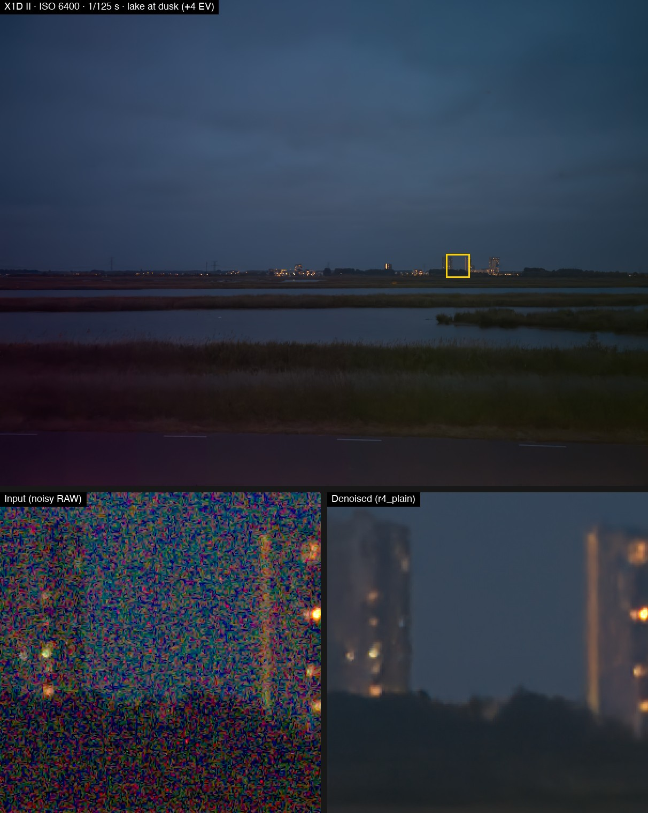
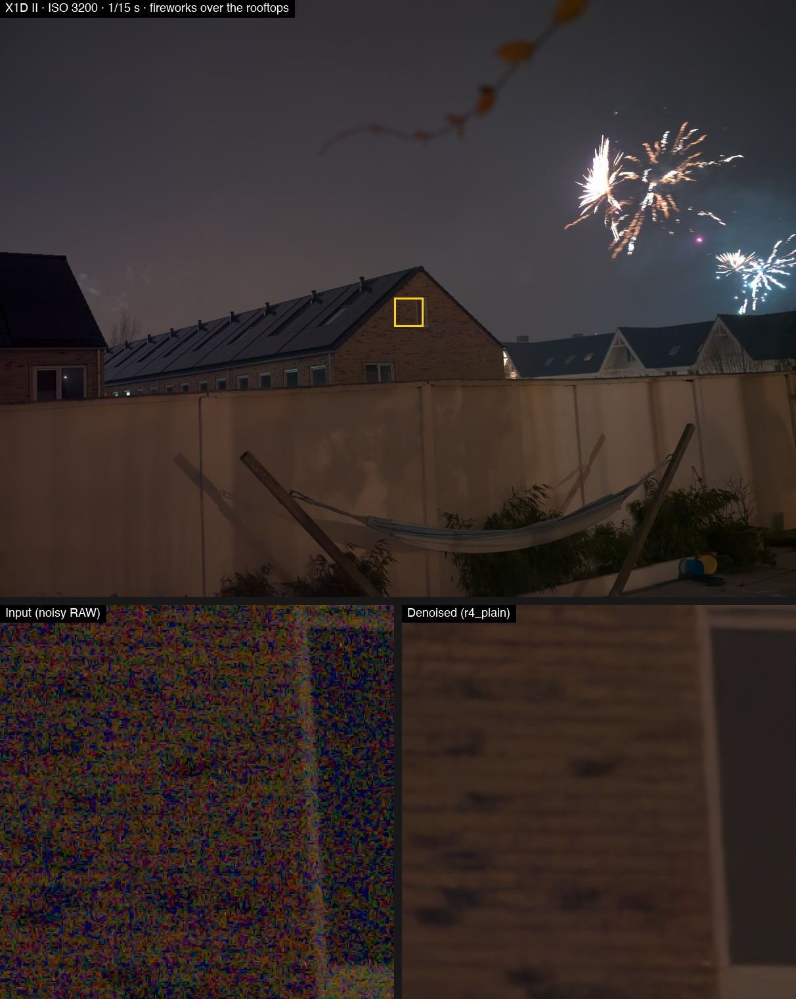
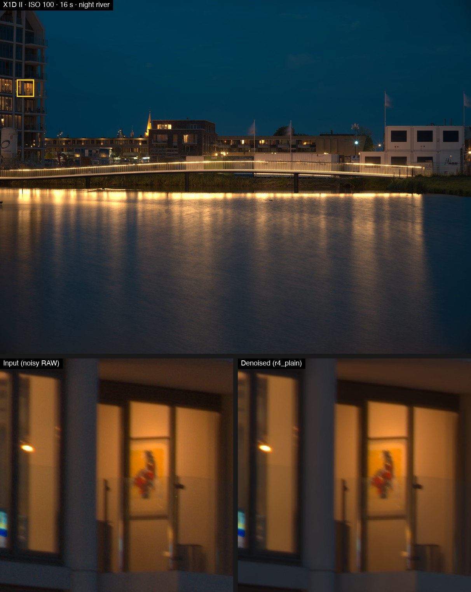

# rawdenoise-lab

## What it is

An experimental neural denoiser for Bayer RAW photographs, operating on sensor data before demosaicing. The repository includes a cross-platform command-line tool, independently trained model artifacts distributed through releases, and research tools for noise modelling, training and evaluation.

> **Current release: `denoiser_1.1` (snapshot `mix_r10_r9p20`).** Trained from scratch on private photographs and calibrated noise models, validated across five Bayer cameras (`X1D II 50C`, `X2D II 100C`, `ILCE-7M3`, `ILCE-5100`, `DSC-RX100M5`) over ISO `100–204800` with **98.7% approval (75/76, 11–1 strict win rate)** on an independent 55-photo blind visual review against `r4_plain` and **3× lower** foliage green-channel split bias. Other Bayer cameras may run, but their denoising quality needs independent validation.

## Examples

Historical qualitative examples from X1D II photographs processed with the earlier `r4_plain` preview:

- **Top of each image:** the denoised frame, with the crop marked in yellow.
- **Bottom of each image:** that crop at 2× (nearest neighbour), noisy input on the left and denoised output on the right.

Input and output use the same camera white balance, sRGB rendering and exposure lift. These illustrations are not paired-ground-truth quality measurements. They were made with `scripts/make_examples.py`.

| | |
|---|---|
|  |  |
| **ISO 3200, 1/250 s.** Grass and mushroom detail example. | **ISO 6400, 1/180 s.** Bark and fungus texture example. |
|  |  |
| **ISO 25600, 1/30 s.** Interior and fabric texture example. | **ISO 6400, pushed +4 EV.** Extreme shadow-lift example with visible fine-detail loss. |
|  |  |
| **ISO 3200, 1/15 s.** Bright fireworks and dark-sky example. | **ISO 100, 16 s.** Long-exposure river and buildings example. |

These examples predate highlight protection. The default `--highlights protect` now preserves input near sensor clipping to reduce denoising-induced colour fringes; clipped colour cannot be recovered, and noise is retained near highlights. The heuristic defect pre-pass can remove isolated single-pixel stars (use a body-specific dark map with `--prepass map`, or `--no-prepass` for astrophotography).

### Experimental 2× RAW Super-Resolution (`PhotoSRv2`)

An isolated clean-room 2× Bayer RAW-to-RAW super-resolution research track lives under `src/denoise_lab/sr/` alongside the production denoiser (kept isolated from production CLI defaults):

- **Interactive comparison & architecture walkthrough:** open [`examples/sr_comparison/index.html`](examples/sr_comparison/index.html) locally in a browser to inspect the two-stage workflow, model layouts (`r4_plain` and `PhotoSRv2`), and 12 real RAW scenes (48 full-resolution regions across Hasselblad X2D II 100C, Hasselblad X1D II 50C, Sony ILCE-7M3, Sony RX100, and the three demo DNGs) with full-picture section navigation, interactive before/after slider, side-by-side comparison, and synchronized 1×–4× zoom.
- **Sample JPEGs:** [`examples/sr_comparison/assets/`](examples/sr_comparison/assets/) contains the per-scene full frames and 1:1 `RAW (2× CFA)`, `Denoised (r4)`, and `PhotoSRv2` comparison crops.
- **Training, benchmark & tests:** `scripts/sr_v2_train.py`, `scripts/sr_benchmark.py`, `scripts/sr_track_a_eval.py`, and `tests/test_raw_sr_v2.py`.

## Quick start

Use Python **3.11 or newer**. From a terminal:

```bash
git clone https://github.com/sndstone/rawdenoise-lab.git
cd rawdenoise-lab
python3 -m venv .venv
source .venv/bin/activate
# Windows PowerShell: .venv\Scripts\Activate.ps1
pip install -e ".[onnx]"

rawdenoise fetch-model
rawdenoise examples/raw/sample_iso3200_mushroom.dng --model denoiser_1.1
```

Alternatively, download `denoiser_1.1_fp32.onnx` from the [model release page](https://github.com/sndstone/rawdenoise-lab/releases/tag/model-denoiser_1.1-2026-11-22), create `models/` and place it there. The three small demo DNGs are already in `examples/raw/`.

The command writes `examples/raw/sample_iso3200_mushroom_denoised.dng`. By default outputs go beside each input with `_denoised` added to the filename. Use `--output-dir outputs` to choose another directory. Existing files and inputs are never overwritten.

## Model files

Download these separately from the [`denoiser_1.1` release](https://github.com/sndstone/rawdenoise-lab/releases/tag/model-denoiser_1.1-2026-11-22); keep model artifacts under `models/`. The earlier [`r4_plain` preview release](https://github.com/sndstone/rawdenoise-lab/releases/tag/model-r4_plain-2026-10-30) remains available in the registry (`--name r4_plain`).

| Release asset | Purpose |
|---|---|
| `denoiser_1.1_fp32.onnx` | Recommended portable fp32 ONNX inference model |
| `denoiser_1.1_weights.pt` | PyTorch weights and model configuration (snapshot `mix_r10_r9p20`) |
| `denoiser_1.1_fp16.mlpackage.zip` | Core ML package; unzip under `models/` before use on macOS |
| `MODEL_CARD.md` | Training scope, blind review results, model details and limitations |
| `SHA256SUMS` | SHA-256 checksums for verifying downloaded assets |
| `sample_iso3200_mushroom.dng` | Demo Bayer crop, also included in the repository |
| `sample_iso25600_living_room.dng` | Demo Bayer crop, also included in the repository |
| `sample_iso100_night_river.dng` | Demo Bayer crop, also included in the repository |

Read the model card before using the checkpoint. Download `SHA256SUMS` alongside the artifacts and compare each downloaded file's SHA-256 with its listed entry (for example, `sha256sum models/denoiser_1.1_fp32.onnx` on Linux).

## Using your own RAWs

From the repository root:

```bash
rawdenoise photo.3FR other.DNG --model models/denoiser_1.1_fp32.onnx --output-dir outputs --device cpu
rawdenoise photo.ARW --model models/denoiser_1.1_weights.pt --strength 0.7
rawdenoise photo.3FR --model models/denoiser_1.1_fp16.mlpackage --format tiff
rawdenoise photos/ --recursive --glob '*.DNG' --model denoiser_1.1 --output-dir outputs --skip-existing --report runs/batch.json
rawdenoise photo.DNG --model denoiser_1.1 --strength 0.5 --chroma-strength 0.9
rawdenoise --version
rawdenoise --help
```

Folder inputs detect common RAW extensions without regard to case. `--glob` adds a case-sensitive filter (quote it so your shell does not expand it); `--recursive` searches subdirectories. Generated `*_denoised` files are excluded from folder discovery. With `--output-dir`, folder-relative subdirectories are retained. Explicit file inputs remain supported, including RAW extensions outside the discovery list.

Existing outputs cause per-file failures by default; `--skip-existing` explicitly counts them as skipped. Inputs and outputs are never overwritten. Processing continues after a file fails, prints success/skip/failure counts, and exits non-zero if any file failed. `--report PATH.json` writes a new JSON file with a `files` list and `summary` counts. Each record includes status, input/output, camera, ISO, backend/device, elapsed seconds, model SHA-256, settings and warnings; failures also include an error. Metadata unavailable for failed or skipped inputs is `null`. Reports are never overwritten. Unknown model training scope, unvalidated cameras and ISO outside the registered training prior produce warnings, not rejection.

Download models with the standard-library HTTPS downloader (no GitHub CLI needed):

```bash
rawdenoise fetch-model --name denoiser_1.1 --format onnx --dir models
rawdenoise fetch-model --format pt
rawdenoise fetch-model --format coreml
# Equivalent standalone entry point:
rawdenoise-fetch --format onnx
```

Downloads are verified against the release's `SHA256SUMS` before installation; ONNX and PT also have pinned hashes in the registry. Core ML archives are unpacked to `.mlpackage` directories. Existing models are refused. `--model denoiser_1.1` resolves locally under `models/`, preferring ONNX, then PT, then Core ML; select a specific installed format with `--backend`. Inference never downloads implicitly. A custom `--dir` requires an explicit model path at inference. Package hashes in reports cover sorted relative filenames and file bytes, while single-file models use the file SHA-256. Downloaded checksums verify integrity; unpinned Core ML checksums depend on trust in the HTTPS release source.

Inputs must be rawpy-readable 2×2 RGB Bayer RAWs (RGGB, BGGR, GRBG or GBRG). X-Trans and Foveon are unsupported. Only unconditioned models are supported. Successful decoding from another camera does not validate its denoising quality.

| Backend | Install | Platforms and device selection |
|---|---|---|
| PyTorch `.pt` | `pip install -e '.[torch]'` | Windows, Linux, macOS; auto selects CUDA, then MPS, then CPU |
| ONNX CPU `.onnx` | `pip install -e '.[onnx]'` | Windows, Linux, macOS |
| ONNX CUDA `.onnx` | `pip install -e '.[onnx-gpu]'` | Windows/Linux with compatible NVIDIA CUDA libraries |
| ONNX DirectML `.onnx` | `pip install -e '.[directml]'` | Windows |
| Core ML `.mlpackage` | `pip install -e '.[coreml]'` | macOS with coremltools |

The base install no longer includes torch. Use `.[torch]` for `.pt` inference,
`.[train]` for training, or `.[dev,onnx]` for development and tests. `.[export]`
includes torch and the export tools; `.[coreml]` installs only the Core ML runtime.
Existing environments with torch keep working. These extras also work with a
regular install, for example `pip install 'denoise_lab[onnx]'` when distributed.

Core ML accepts `--compute-units all|cpu_and_ne|cpu_and_gpu|cpu_only`; the default is `all`, or `cpu_only` with `--device cpu`, and JSON reports record the resolved selection. This option is rejected for other backends; `--device cpu` conflicts with selections other than `cpu_only`.

Choose one ONNX Runtime variant per environment. ONNX auto selects available providers in CUDA, DirectML, Core ML, CPU order. `--device cpu` forces CPU; ONNX and Core ML accept only `auto` or `cpu`. PyTorch also accepts device strings such as `cuda:0` or `mps`; install a suitable PyTorch build for your accelerator. ONNX and Core ML use NumPy preprocessing and tiling; neither requires torch. `--backend` can override selection by model suffix.

`--strength` blends the complete processed result against the original, from 0 (preserve input) to 1 (full processing). `--chroma-strength` defaults to the same value, reproducing the original blend exactly. Set it independently to adjust colour denoising: each packed Bayer cell is transformed using camera white balance into Y=(R+2G+B)/4, Cb=B−Y and Cr=R−Y, with G=(G1+G2)/2. Y and G1−G2 follow `--strength`; Cb/Cr follow `--chroma-strength`. This is a linear sensor-space blend before unpacking; it does not clip signed values. `--no-prepass` (or `--prepass off`) disables hot/dead-pixel correction. `--overlap` controls tile overlap in packed pixels (default 60; twice that extent in sensor pixels).

Calibrate a body-specific map from repeated dark frames (at least two per ISO/exposure/shutter setting):

```bash
PYTHONPATH=src python scripts/build_defect_map.py data/my_darks --shutter mechanical --output-dir calib/defect_maps
rawdenoise photo.ARW --model models/denoiser_1.1_weights.pt --defect-map calib/defect_maps/MODEL_SERIAL.npz --prepass map
# Auto-lookup requires both model and serial in standard RAW metadata:
rawdenoise photo.ARW --model models/denoiser_1.1_weights.pt --defect-map-dir calib/defect_maps
```

Dark directories can use a `manifest.json` list of `file`, `iso`, `exposure` (seconds or a rational), optional `shutter`, `model` and `serial`; otherwise settings come from standard TIFF/EXIF. Keep each set to one physical body. Unknown serials require explicit map selection. Maps and other generated calibration artifacts stay out of git.

`--prepass auto` uses mapped correction when a map is supplied/matched; otherwise it keeps the existing heuristic. Available modes are `auto`, `map`, `heuristic`, `map+heuristic`, and `off`. Maps correct only listed sites using unlisted same-colour neighbours. Known identity/geometry mismatches and unobserved ISO/exposure settings are rejected; build separate shutter-mode maps. Darks cannot confirm dead photoresponse or long-exposure/temperature stability, and confidence is empirical support rather than a probability. Unmapped stars survive the map pre-pass; the neural model can still change them. See [calibration and evaluation details](docs/09-clean-targets-and-defects.md#calibrated-dark-frame-maps).

`--highlights protect` (default, all backends) preserves input Bayer cells where any photosite reaches 98% of its normalized per-channel white level, including a one-packed-pixel border, then feathers over three more packed pixels. The input used for this protection includes enabled defect corrections, so known hot pixels are not restored. Linear sensor headroom above `1.0` is preserved rather than prematurely clamped, preventing purple/magenta colour shifts in clipped highlights; unclipped photosites stay below white. This final protection follows the strength blend (strength 0 still preserves input exactly). It retains input noise; `--highlights off` restores legacy processing. Inputs without near-clipped photosites are unchanged by this protection.

Experimental seam and green-symmetry controls are opt-in: `--align-tiles` aligns origins and steps to
16 packed pixels (rounding overlap 60 up to 64), `--feather-mode cosine` changes
the blending window, `--tta-shift N` averages N evenly spaced diagonal tile
grids, and `--tta-transpose` averages the original tile with a `G1↔G2` Bayer-transposed
pass (roughly 2× compute, halving residual foliage `G1−G2` bias). Shift averaging costs roughly N passes and does not guarantee phase
invariance. Wider overlaps can also increase the tile count. See
[tile-phase diagnostics](docs/05-evaluation.md#tile-phase-diagnostics).

The default DNG output contains the visible sensor mosaic rounded/clipped to uint16, with source CFA layout, black/white levels, color matrix, camera white balance and orientation. `--metadata full` (the default) also preserves available standard camera/lens, ISO, exposure, date, artist/copyright and GPS metadata, plus DNG colour matrices, calibration and profile tags. GPS is retained when present; use `--metadata minimal` to omit capture metadata and reproduce the legacy writer. A bounded TIFF/EXIF reader supports TIFF-based RAWs without external tools; opaque proprietary metadata is unavailable.

Full output identifies the rawdenoise version and processing, records the source filename, regenerates the raw-data ID and embeds a small approximate sRGB browsing preview (disable with `--no-dng-preview`). Visible-area export resets ActiveArea and default crop bounds to the output dimensions. OpcodeList1 is omitted because pre-demosaic operations may depend on removed pixels or repeat decoder corrections. OpcodeLists2/3 are preserved only when no sensor margins were removed. Other standard lens/profile tags are copied, but embedded extra profiles, masked pixels, maker notes, signatures, checksums and original previews are not preserved. Retain the original RAW and check results in your editor; preview colour and metadata support vary by application. `--format tiff` renders a 16-bit sRGB preview using camera white balance without automatic brightening. `--format npy` saves the signed float32 normalized visible mosaic in the source CFA layout without metadata.

## How it works

The model uses NAFNet (Nonlinear Activation Free Network), a neural image-restoration architecture. Preprocessing subtracts black levels, normalizes by sensor white levels, corrects likely defective pixels, and packs each 2×2 Bayer cell into R/G1/B/G2 planes. Inference runs on overlapping 512×512 packed-pixel tiles, blends them with feathered weights, and reconstructs the sensor mosaic. The released model was trained from random initialisation with synthetic noise on private photographic targets.

## Limitations

- `denoiser_1.1` has been validated across five Bayer cameras (`X1D II 50C`, `X2D II 100C`, `ILCE-7M3`, `ILCE-5100`, `DSC-RX100M5`); other cameras and real noise conditions still need independent validation.
- Private training photographs are unavailable, so the complete training experiment cannot be reproduced from this checkout.
- Fine texture can be lost, clipped colour cannot be recovered, and defect correction can remove isolated stars. Highlight protection reduces denoising-induced colour shifts by retaining noisy input near clipping; it does not guarantee artifact-free highlights or correct demosaicing/WB colour shifts.
- Overlap blending does not guarantee tile-phase-independent neural predictions or eliminate all seams.
- Output metadata is limited; preserve original files and inspect results before further processing.

### Data-provenance ground rules

1. Training starts from random initialisation. Training targets and model-selection evidence must have documented independent provenance. Do not initialise, fine-tune or distil from third-party weights, or use third-party denoised outputs as targets, pseudo-labels or selection signals.
2. Every training file needs a recorded source and applicable usage terms; see [data guidance](docs/03-data.md). Data restricted to non-commercial use must not feed models intended for shipment. Verify terms for the exact dataset version and intended use before inclusion.
3. Data and weights stay out of git. Ignore rules cover local data directories and common model/RAW formats. The only RAW exceptions are the three approved 1024×1024 crops of the owner's photographs in `examples/raw/`; these are CLI examples and never training data.
4. Acceptance requires matched real-photo checks per camera/ISO band, independent clean references where available, and the owner's blind visual review. Synthetic peak signal-to-noise ratio (PSNR) gains alone never promote a model; see [evaluation](docs/05-evaluation.md).

## Research and docs

See the [script catalog](scripts/README.md) for active commands and the historical archive.

| Document | Scope |
|---|---|
| [01 — Deployment contract](docs/01-what-we-know.md) | Tensor layout, tiling and runtime interface |
| [02 — Approach](docs/02-approach.md) | Historical proposal and research roadmap |
| [03 — Data](docs/03-data.md) | Provenance, capture protocols and data preparation |
| [04 — Training](docs/04-training.md) | Historical prototype recipes and training/export notes |
| [05 — Evaluation](docs/05-evaluation.md) | Metrics and acceptance requirements |
| [06 — Provenance](docs/06-clean-room.md) | Independent implementation and training provenance |
| [07 — Architecture study](docs/07-architecture-study.md) | Historical architecture experiments, superseded by later rounds |
| [08 — Round 2](docs/08-nafnet-round2.md) | Historical capacity and training-length experiments |
| [09 — Clean targets and defects](docs/09-clean-targets-and-defects.md) | Later training rounds, target preparation and defect handling |
| [10 — Rounds 5–7](docs/10-rounds-6-7.md) | Camera calibration, real-noise self-supervision, tools and negative results |
| [11 — Capture protocol](docs/11-capture-protocol.md) | Tripod burst checklist and preview capture checker |
| [12 — Burst alignment](docs/12-burst-alignment.md) | Sub-pixel registration, robust merge and usable-area results |
| [13 — Physics noise](docs/13-physics-noise.md) | Banding, quantisation and shutter-profile noise synthesis |
| [References](docs/references.md) | Papers and research resources |

The code and configs retain exploratory experiments. Historical recipes are not the released model's training instructions. `scripts/train_arch_study.py` supports the later binned-target/defect/EMA experiments; `scripts/train.py` also provides the small smoke fixture below. `scripts/run_cuda.py` is optional research tooling requiring a separately prepared Docker/NVIDIA environment.

## Development

From the repository root in the activated environment:

```bash
pip install -e '.[dev,onnx]' onnx
pytest -q tests/
python scripts/train.py --config configs/smoke.yaml --device cpu
```

The 20-step smoke run uses random fixtures and illustrative calibration, writes `runs/smoke/last.pt`, and checks training plumbing only. It does not produce a camera denoising model. See [CONTRIBUTING.md](CONTRIBUTING.md) for contribution and provenance requirements.

For export, install `pip install -e '.[export]'`. ONNX export includes an ONNX Runtime CPU parity check; `--weights ema` selects EMA weights when present (also supported by the Core ML exporter). For example:

```bash
python scripts/export_onnx.py --checkpoint models/denoiser_1.1_weights.pt --output models/denoiser_1.1_fp32.onnx --precision fp32 --dynamic
```

Dynamic height/width must be multiples of 16 for the four-stage model. Deployment uses 512 packed-pixel tiles.

## License

No license has been chosen yet; until a LICENSE file is added, all rights are reserved by the author.
